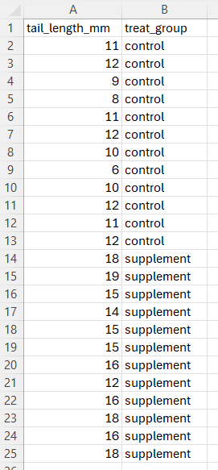

# R workshop 3:<br>Statistical analysis in R

## Workshop 3 overview

In the third and final workshop, you will use the skills you have developed so far to analyse a new dataset and conduct an independent samples t-test.

### Learning outcomes

::: {.callout-tip icon="false"}
### []{style="color: #872046;"}  Learning outcomes

By the end of this workshop, you should be able to:

- Apply data exploration, grouped descriptive statistics, and boxplots to compare groups in a given dataset
- Copy and save plots created with ggplot2
- Run a t-test to statistically compare two groups of measurements
:::

### Workshop outline

In Workshop 2, we compared groups of measurements using descriptive statistics and boxplots. Specifically, we compared the body masses of different penguin species.

In this workshop, we will apply these skills to a new dataset and extend them by carrying out an independent-samples t-test to compare two independent groups.

::: {.callout-tip icon="false"}
### []{style="color: #872046;"}  Analysis aim

Investigate whether adding a supplement to hamster pup diet will affect tail growth.

To do this, we will compare the tail lengths of hamsters in the control group (standard diet) with those in the treatment group (standard diet plus supplement).
:::

## Setup {#setup}

### R setup

::: {.callout-caution icon="false"}
### []{style="color: #2E6B4E;"}  Task
- Follow the steps below to get set up for this workshop
:::

**Step 1: Open RStudio**

Open RStudio (you do not need to open R separately).

**Step 2 (OPTIONAL): Clear your environment**

Run the following code or use the broom icon in the Environment pane to clear your workspace:

```{r}
#| eval: false
rm(list = ls())
```

(You do not need to do this every time you use R, only if you want to start with a fresh workspace.)

**Step 3: Create a new script**

Create a new script and save it in your dedicated folder for the R work on this module.

**Step 4: Install required packages**

***You can skip this step if you have previously installed these packages***

Copy the code below into your *console* and run it. This will install the readxl package, which we'll use for importing Excel data, and the ggplot2 package, which we'll use for plotting. 

```{r}
#| eval: false
install.packages("readxl")
install.packages("ggplot2")
```

**Step 5: Load required packages**

Below is the code for *loading* the packages that are needed for this workshop. Copy the code and paste it into the top of your new *script*, then run the code.

```{r}
#| message: false
#| warning: false
#| results: "hide"
library(readxl)
library(ggplot2)
```

::: {.callout-note icon="false" collapse="true"}
### []{style="color: #9e9e9e;"}  Packages need to be loaded in each R session
Loading a package makes its functions available for use in your current R session. Unlike installation, packages must be loaded each time you start R.
:::

### About the workshop 3 data

A group of scientists are investigating whether adding a supplement to hamster pup diet will affect tail growth.

A control group was given the standard diet, whilst a treatment group was given the supplement in addition to the standard diet.

The tail length was recorded in mm after five months of development.

{width="200" style="display:block; margin: 2em auto;"}
In the Excel spreadsheet shown above, each row corresponds to one hamster. One column contains the hamster's tail length, while another identifies the treatment group to which it belongs.

::: {.callout-tip icon="false"}
### []{style="color: #872046;"}  Analysis aim

Investigate whether adding a supplement to hamster pup diet will affect tail growth.

To do this, we will compare the tail lengths of hamsters in the control group (standard diet) with those in the treatment group (standard diet plus supplement).
:::


### Importing the workshop 3 data

In workshop 2, we learnt how to import data from an Excel file into R. We will repeat this process to import our workshop 3 data.

::: {.callout-caution icon="false"}
### []{style="color: #2E6B4E;"}  Task
- Import the "Workshop 3 data" Excel file into R by following the steps below
:::

**Step 1: Check that the readxl package is installed and loaded**

Confirm that the `readxl` package has successfully installed and loaded in your session by checking that `readxl` is ticked in the Packages tab of the Output pane (as shown in the screenshot below).

{width="500" style="display:block; margin: 2em auto;"}

**Step 2: Save the Excel file**

- Download the Workshop 3 data.xlsx file from the **Week 6 R Workshop folder on SurreyLearn**
- Move the downloaded file from your Downloads folder to the dedicated folder for your R work on this module. This should be the same location where your R script is saved

**Step 3: Set your working directory**

Set your working directory by clicking: Session > Set Working Directory > To Source File Location, as shown below.

{width="600" style="display:block; margin: 2em auto;"}
You can also set the working directory manually by selecting "Choose Directory...", rather than "To Source File Location". For example, if your Excel file is stored in a different folder from your R script, you should choose the folder containing the Excel file as your working directory.

**Step 4: Copy the code for setting the working directory into your script**

After setting the working directory, you should see a line of code similar to the one below appear in the Console. (The `setwd() function` tells R which folder to use as the working directory, and the text inside the brackets is the file path to that folder.)

{width="500" style="display:block; margin: 2em auto;"}

Copy and paste this line of code into your script (not including the `>` symbol). (The file path in your line of code will be different, as it will refer to the specific folder on your computer where your files are saved.)

**Step 5: Import the data using the read_excel() function**

Copy the line of code below into your script and run it. This command imports the data using the `read_excel()` function and assigns it the name "ws3data".

```{r}
#| results: hide
ws3data <- read_excel("Workshop 3 data.xlsx")
```

**Step 6: Check the data has imported successfully**

Check that a data frame called "ws3data" now appears in the Environment tab of the environment pane, as shown below.

{width="400" style="display:block; margin: 2em auto;"}

::: {.callout-note icon="false" collapse="true"}
### []{style="color: #9e9e9e;"}  Things to check if you're having issues importing data

- Make sure the Excel file is closed when you run the code to import the data
- Check that the spelling of the file name inside the `read_excel()` function exactly matches the spelling of the file name
- Check that the file extension is correct (e.g. `.xlsx` rather than `.xls`)
- Make sure the Excel file is saved in your current working directory.
- Check that you have set the working directory to the correct folder (you can run the command `getwd()` to check what the working directory is set to)
- Ensure that you have loaded the `readxl` package 
:::

***Video***

The video below demonstrates how to import a file from Excel, including some things to check if it is not working.

A couple of things to note about the video:

- The video imports a file called "iris" - ours is called "penguins", so whenever the video refers to "iris", replace this with "penguins" in your code.
- The video uses [Session > Set Working Directory > *Choose Directory*] to import the data. We have used [Session > Set Working Directory > *To Source File Location*] since this is quicker if your Excel file is saved in the same location as your script, but either method is fine.
- The "previous video" referred to in the video is the video about installing packages, which is included in the workshop 1 materials.

<div style="text-align: center;">
  <iframe
    width="80%"
    style="aspect-ratio: 16 / 9;"
    src="https://www.youtube.com/embed/rJljmh2CEZU"
    title="YouTube video player"
    allowfullscreen>
  </iframe>
</div>

::: {.callout-note icon="false" collapse="true"}
### []{style="color: #9e9e9e;"}  Video timestamps
- 0:00 – Introduction (and recap of installing the readxl package)
- 0:40 – Setting the working directory - how and why
- 2:09 – Checking your current working directory using getwd()
- 2:28 – Importing data (.xls and .xlsx files) using the read_excel function
- 2:59 – Common errors when importing Excel files
- 4:13 – Viewing the imported data
:::

## Further practice: Exploring data, producing grouped descriptives and creating boxplots

In workshop 2, we explored the penguins dataset and used descriptive statistics and a boxplot to compare body mass across species.

We will now follow the same process to investigate differences in tail growth between two groups of hamsters.

::: {.callout-tip icon="false"}
### []{style="color: #872046;"}  Learning outcome

- Apply data exploration, grouped descriptive statistics, and boxplots to compare groups in a given dataset
:::

### Exploring the data

It’s a good idea to explore and get to know the data you’re working with before starting any analysis. 

We saw some useful functions for doing this in workshop 2.

**View the whole data frame**

We could view the entire data frame in the console by typing its name and running it, but it's often nicer to view it in the Source pane. You can do this either by clicking on the data frame in the Environment pane (which automatically runs `View()`), or by using the `View()` function directly:

::: {.panel-tabset group="language"}
## R

```{r}
#| eval: false
View(ws3data)   
```
:::

{width="400" style="display:block; margin: 2em auto;"}

:::: {.callout-caution icon="false"}
### []{style="color: #2E6B4E;"}  Task
Using R functions we have seen so far, investigate the data frame:

- How many hamsters are in the sample?
- How many hamsters are in each group?
- What is the data type of each variable?
- Are there any variables that should be converted to factors? If so, do so.
- Produce a descriptive summary of the data frame.
- What is the mean tail length?

::: {.callout-caution icon="false" collapse="true"}
### []{style="color: #2E6B4E;"} Answer

```{r}
# Number of hamsters 
nrow(ws3data)

# (Alternatively, the number of obs is shown in the Environment tab,
# or we could just open the data frame to see how many rows it has)

# Number of hamsters in each group
table(ws3data$treat_group)

# View data types
str(ws3data) 

# treat_group should be a factor because it represents a 
# fixed set of treatment groups (control and supplement)

# Convert treat_group to a factor
ws3data$treat_group <- as.factor(ws3data$treat_group)

# Descriptive summary
summary(ws3data)

# Using the results of the summary function, mean tail length is 13.17mm

# Alternatively, we could use the mean function:
mean(ws3data$tail_length_mm)

```
::: {style="margin-top: 0.1em;"}
:::

:::

::: {style="margin-top: 0.1em;"}
:::

::::

### Grouped descriptive statistics

Often, we want to obtain descriptive statistics broken down by certain subsets of data i.e. *grouped* descriptive statistics.

We can see that this might be helpful for us here, because we want to compare tail growth between the supplement and the control group.

Recall from workshop 2 that the `by()` function can be used to find grouped descriptive statistics:

::: {.panel-tabset .panel-blue}
## Template code - using the by() function

```{r}
#| eval = FALSE
by(______________________, ____________________, _______________)
    column to summarise     column to group by    function
```

- In the `column to summarise` blank, enter the variable you want to calculate a statistic for. For example, penguins$body_mass_g.
- In the `column to group by` blank, enter the variable that defines the groups. For example, penguins$species.
- In the `function` blank, enter the summary statistic you want to calculate. For example, mean, median, sd etc.
:::

::: {.callout-note icon="false" collapse="true"}
### []{style="color: #9e9e9e;"}  Recall: use $ to select a column from a data frame

Remember that to select a column from a data frame, we need to use the `$` operator, e.g. to select the `tail_length_mm` column from the `ws3data` data frame, we would use `ws3data$tail_length_mm`.
:::

To use the `by()` function to produce descriptive statistics for tail length in each treatment group in the workshop 3 dataset (`ws3data`):

- Our "column to summarise" is `ws3data$tail_length_mm`, because this contains the measurements that we want to summarise
- Our "column to group by" is `ws3data$treat_group`, because this contains the treatment groups for which we want separate summaries
- The "function to use" is the R function corresponding to the summary measure you want to calculate. For example, use `mean` for the mean, 'median' for the median etc.

So altogether, to find the mean tail length for each treatment group, we would use the command:

::: {.panel-tabset group="language"}
## Example - using the by() function

```{r}
by(ws3data$tail_length_mm, ws3data$treat_group, mean)
```
:::

::: {style="margin-top: 2em;"}
:::

:::: {.callout-caution icon="false"}
### []{style="color: #2E6B4E;"}  Task
Apply the `by()` function to the workshop 3 data (`ws3data`) to:

- Find the median tail length of each group
- Find the standard deviation of the tail length of each group
- Find the minimum tail length in each group
- Find the maximum tail length in each group

What can we say about the differences in tail length between the groups?

::: {.callout-caution icon="false" collapse="true"}
### []{style="color: #2E6B4E;"} Answer

```{r}
# Median tail length of each treatment group
by(ws3data$tail_length_mm, ws3data$treat_group, median)

# Standard deviation of the tail length of each group
by(ws3data$tail_length_mm, ws3data$treat_group, sd)

# Minimum tail length in each group
by(ws3data$tail_length_mm, ws3data$treat_group, min)

# Maximum tail length in each group
by(ws3data$tail_length_mm, ws3data$treat_group, max)
```
::: {style="margin-top: 0.1em;"}
:::

Based on these summaries, the supplement group appear generally to have longer tails than the control group:

- The mean tail length is higher in the supplement group (16 mm) than in the control group (10.3 mm)
- The median tail length is also higher in the supplement group (16 mm) than in the control group (11 mm)
- The standard deviations are similar (2 mm in the supplement groups, 1.9 mm in the control group), indicating a similar amount of variability in the two groups
- The minimum and maximum values are higher in the supplement group (12 to 19 mm) than in the control group (6 to 12 mm)
:::

::: {style="margin-top: 0.1em;"}
:::

::::

### Creating a boxplot with ggplot2

In workshop 2 we learnt how to create a boxplot using the ggplot2 package.

This is the template code:

::: {.panel-tabset .panel-blue}
## Template code - boxplot

```{r}
#| eval: false
ggplot(_________, aes(x = _________, y = ________)) +
  geom_boxplot() +
  labs(x = "_______",
       y = "_______")
```

- Fill in the first blank with the name of the data frame you want to use for plotting
- Fill in the second blank (after x =) with the name of the variable (column) in the data you want to plot on the x-axis
- Fill in the third blank (after y =) with the name of the variable (column) in the data you want to plot on the y-axis
- Fill in the blanks inside the `labs()` function with the corresponding x and y labels that you want to add to your plot. These should be in quotation marks.

:::

:::: {.callout-caution icon="false"}
### []{style="color: #2E6B4E;"}  Task
Using the workshop 3 data (`ws3data`):

- Produce a boxplot to visually compare tail lengths between the two treatment groups

::: {.callout-caution icon="false" collapse="true"}
### []{style="color: #2E6B4E;"} Answer

```{r}
# Plot a box plot of tail length by treatment group

ggplot(ws3data, aes(x = treat_group, y = tail_length_mm)) +
  geom_boxplot() +
  labs(x = "Treatment groups",
       y = "Tail length (mm)")
```
::: {style="margin-top: 0.1em;"}
:::

:::

::: {style="margin-top: 0.1em;"}
:::

::::

## ggplot2: Extension material

### Additional customisation options

### Changing the fill colour of the boxes

**Variable aesthetics**

In ggplot2, `aes` (short for "aesthetics") refers to the visual properties of the plot - things like position (x and y), colour, size, and shape - and how variables in your data are mapped to them.

We have already used `x=` and `y=` inside the `aes()` function to map variables to the axes.

We can also map variables to other properties such as colour.

::: {.panel-tabset .panel-blue}
## Template code - boxplot including fill colour by box

In your existing boxplot code, add the argument `fill = ` as an additional argument inside the `aes()` function:

```{r}
#| eval: false
ggplot(_________, aes(x = _________, y = ________, fill = _________)) +
  geom_boxplot() +
  labs(x = "_______",
       y = "_______")
```

- In the blank after `fill =`, fill in the name of the variable used on the x-axis (i.e. the variable that defines the boxes) 
- e.g. `fill = treatment_group`

:::

**Fixed aesthetics**

So far we have used `geom_boxplot()` with no arguments inside the brackets, but there are lots of additional customisation options available by specifying arguments inside it.

Whereas aesthetics specified inside the `aes()`function map a *variable* to a visual property, aesthetics can be specified inside `geom_boxplot()` to set a visual property to a constant value i.e. the same property for the whole plot.

For example, if we put `fill = "blue"` will colour all of the boxes blue.

::: {.panel-tabset .panel-blue}
## Template code - boxplot including fill colour by box

In your existing boxplot code, add the argument `fill = ` as an argument inside the `geom_boxplot()` function:

```{r}
#| eval: false
ggplot(_________, aes(x = _________, y = ________)) +
  geom_boxplot(fill = _________) +
  labs(x = "_______",
       y = "_______")
```

- In the blank after `fill =`, fill in a colour in quotations


[link to all colour options]

:::

**Themes**

There are various theme components that can be added as a separate component to change the overall appearance of the plot (background, gridlines, fonts etc.).

Some common one

::: {.panel-tabset .panel-blue}
## Template code: adding a theme to a boxplot
```{r}
#| eval: false
ggplot(_________, aes(x = _________, y = ________)) +
  geom_boxplot() +
  labs(x = "_______",
       y = "_______") +
  theme_xxx()
```

- Add an additional theme component at the end of your code, replacing `theme_xxx` with the name of the specific theme you want to use.

Some common ones are:

- `theme_minimal()`
- `theme_classic()`
- `theme_bw()`
::: 

### Additional tasks

:::: {.callout-caution icon="false"}
### []{style="color: #2E6B4E;"}  Task
In the previous section you produced a boxplot to compare tail lengths between treatment groups. Now customise your plot:

- Add the argument `fill = treat_group` to the `aes()` function to tell R to colour the boxes according to the treatment group
- Add to a theme to your plot to change the overall look
- Add the component `+ scale_fill_manual(values = c("red", "green"))` to your plot. This allows you to specify the colours used for the boxes. If you use (`fill = treat_group` on its own, R will choose the colours automatically.) 

::: {.callout-caution icon="false" collapse="true"}
### []{style="color: #2E6B4E;"} Answer

```{r}
# Add the argument `fill = treat_group` to the `aes()` function to tell R to colour the boxes according to the treatment group

ggplot(ws3data, aes(x = treat_group, y = tail_length_mm, fill = treat_group)) +
  geom_boxplot() +
  labs(x = "Treatment groups",
       y = "Tail length (mm)")

# Add to a theme to change the overall look
# Below uses theme_minimal(), which gives the plot a cleaner appearance

ggplot(ws3data, aes(x = treat_group, y = tail_length_mm, fill = treat_group)) +
  geom_boxplot() +
  labs(x = "Treatment groups",
       y = "Tail length (mm)") +
  theme_minimal()

# Add the component `+ scale_fill_manual(values = c("red", "green"))` to colour the boxes red and green 

ggplot(ws3data, aes(x = treat_group, y = tail_length_mm, fill = treat_group)) +
  geom_boxplot() +
  labs(x = "Treatment groups",
       y = "Tail length (mm)") +
  theme_minimal() +
  scale_fill_manual(values = c("red", "green"))

# Change to blue and yellow!

ggplot(ws3data, aes(x = treat_group, y = tail_length_mm, fill = treat_group)) +
  geom_boxplot() +
  labs(x = "Treatment groups",
       y = "Tail length (mm)") +
  theme_minimal() +
  scale_fill_manual(values = c("blue", "yellow"))

```
::: {style="margin-top: 0.1em;"}
:::

:::

::: {style="margin-top: 0.1em;"}
:::
::::

:::: {.callout-caution icon="false"}
### []{style="color: #2E6B4E;"}  Task
- The iris data set, built into R, contains data on 150 iris flowers. Store it as a data frame using the following line of code: `iris <- data.frame(iris)`

::: {.callout-caution icon="false" collapse="true"}
### []{style="color: #2E6B4E;"} Answer

```{r}
#| results: hide
iris <- data.frame(iris)
```
::: {style="margin-top: 0.1em;"}
:::
:::

- Create a boxplot of petal length by species

::: {.callout-caution icon="false" collapse="true"}
### []{style="color: #2E6B4E;"} Answer

```{r}
# Boxplot of petal length by species
ggplot(iris, aes(x = Species, y = Petal.Length)) +
  geom_boxplot() +
  labs(title = "Petal Length by Species",
       x = "Species",
       y = "Petal Length")
```
::: {style="margin-top: 0.1em;"}
:::
:::

- Colour the boxes manually to be yellow, purple and orange
```{r}
# Boxplot of petal length by species
ggplot(iris, aes(x = Species, y = Petal.Length, fill = Species)) +
  geom_boxplot() +
  scale_fill_manual(values = c("yellow","purple","orange")) +
  labs(title = "Petal Length by Species",
       x = "Species",
       y = "Petal Length")
```

- Remove the legend (this link may be helpful: https://r-graph-gallery.com/239-custom-layout-legend-ggplot2.html)
```{r}
# Boxplot of petal length by species
ggplot(iris, aes(x = Species, y = Petal.Length, fill = Species)) +
  geom_boxplot() +
  scale_fill_manual(values = c("yellow","purple","orange")) +
  labs(title = "Petal Length by Species",
       x = "Species",
       y = "Petal Length") +
  theme(legend.position = "none") 
```

- Add the component `+ geom_point()`
- What does this do?
```{r}
# Add the component + geom_point()
# This overlays the raw data
ggplot(iris, aes(x = Species, y = Petal.Length, fill = Species)) +
  geom_boxplot() +
  geom_point() +                       
  scale_fill_manual(values = c("yellow","purple","orange")) +
  labs(title = "Petal Length by Species",
       x = "Species",
       y = "Petal Length") +
  theme(legend.position = "none") 
```

- Now replace the above component (`+ geom_point()` with: `+ geom_jitter()`
- What does this do?
- Trying adding the arguments `width=0.1` and `alpha=0.3` inside `geom_jitter()`. What effect does each argument have on the appearance of the plot? Try some other values.

```{r}
# Replace geom_point() with geom_jitter()
# Jittering adds a small amount of random horizontal spread to the points,
# making it easier to see individual observations when values overlap

ggplot(iris, aes(x = Species, y = Petal.Length, fill = Species)) +
  geom_boxplot() +
  geom_jitter() +                       
  scale_fill_manual(values = c("yellow","purple","orange")) +
  labs(title = "Petal Length by Species",
       x = "Species",
       y = "Petal Length") +
  theme(legend.position = "none") 
```

```{r}
# Add the arguments `width = 0.1` and `alpha = 0.3` inside `geom_jitter()`
# The width argument controls the amount of horizontal spread applied to the points
# The alpha argument controls transparency (0 = completely transparent,
# 1 = completely opaque)

ggplot(iris, aes(x = Species, y = Petal.Length, fill = Species)) +
  geom_boxplot() +
  geom_jitter(width = 0.1, alpha = 0.3) +                       
  scale_fill_manual(values = c("yellow","purple","orange")) +
  labs(title = "Petal Length by Species",
       x = "Species",
       y = "Petal Length") +
  theme(legend.position = "none") 
```

::: {style="margin-top: 0.1em;"}
:::
::::

## Boxplot interpretation

The bar graph produced in the task above should look like this:

```{r}
#| echo: false
ggplot(ws3data, aes(x = treat_group, y = tail_length_mm)) +
  geom_boxplot() +
  labs(x = "Treatment group",
       y = "Tail length(mm)")
```

::: {.callout-caution icon="false"}
### []{style="color: #2E6B4E;"}  Task
What observations can we make from the bar graph regarding the comparison between the groups?

[Answers]
:::

::: callout-important
### Adding a figure title

This graph currently has no title. In practice, you can add a figure legend by copying the graph into Word and adding a figure legend below the graph.

(It is not possible to add a proper figure caption in a standard R script.)
:::


## Copying and saving plots

::: {.callout-tip icon="false"}
### []{style="color: #872046;"}  Learning outcome

- Copy and save plots created with ggplot2
:::

Once you are happy with a plot, you may want to save it to use elsewhere - for example in a report or presentation.

### Copying a plot

The simplest way to copy a plot is to click the **Export** button in the Plots pane in RStudio, then select **Copy to Clipboard**. You can then paste it directly into a Word document or PowerPoint presentation.


### Saving a plot

To save a plot as an image file, you can either:

- Click **Export** in the Plots pane, then select **Save as Image** and choose the file format, size, and destination


- Use `ggsave()` in your code, which saves the most recently generated plot to a file:

```{r}
#| eval: false 
ggsave("my_plot.png", width = 8, height = 5)
```

`ggsave()` automatically detects the file format from the file extension - common options include `.png`, `.pdf`, and `.jpeg`.

## Statistical tests in R

::: {.callout-tip icon="false"}
### []{style="color: #872046;"}  Learning outcome

- Run a t-test to statistically compare two groups of measurements
:::

### Analysis of Workshop 3 data

To investigate whether adding a supplement to hamster pup diet will affect tail growth, we are comparing the tail lengths of a group of hamster pups who were given the standard diet (control group), to a different group who received the supplement in additional to the standard diet (treated group).

So far, we have summarised the data using descriptive statistics and visualised the comparison in a boxplot.

To test whether there is a *statistically significant* difference between the groups, we can use an independent t-test, which compares the means of two unrelated groups.
 
### Independent t-test

In statistical testing, the **<span style="color:#D57903;">dependent variable</span>**, (also called the response variable or outcome variable) is the variable that we are trying to explain or predict.

We want to see if the **<span style="color:#D57903;">dependent variable</span>** depends on, or is influenced by, one or more **<span style="color:#365AC4;">independent variables</span>**. 

An independent t-test is used when we have a continuous **<span style="color:#D57903;">dependent variable</span>** (DV), and an **<span style="color:#365AC4;">independent variable</span>** that consists of two independent groups.

For example, in our case, we are exploring:

  Is **<span style="color:#D57903;">tail length</span>** influenced by **<span style="color:#365AC4;">treat group</span>**?
  
Or in other words:

  Is there any difference in **<span style="color:#D57903;">tail length</span>** for the **<span style="color:#365AC4;">control vs. supplement</span>** group?

{width="400" style="display:block; margin: 2em auto;"}
The independent t-test tests for a difference between the group means.

### Assumptions for the independent t-test

Statistical tests such as the t-test have **assumptions** – conditions that the data should meet to ensure that results from the test are valid.

Two key assumptions for the independent t-test are:

- The dependent variable is approximately normally distributed for each group of the independent variable
- The dependent variable has roughly equal variances for each group of the independent variable

In real world analyses, it is important to check these assumptions before performing the t-test.

::: callout-important
### Note

For the purposes of the R work in this module, you do not need to check these assumptions - you can assume that these assumptions are met.
:::

### Carrying out an independent t-test:

An R command to run a t-test follows the below structure:

::: {.panel-tabset .panel-blue}
## Template code: independent t-test

```{r}
#| eval: false
_______________ <- t.test(_____~______, data = ____________, var.equal=TRUE)
 results name              DV     IV            dataframe
```

- `results name` is a name you choose to store the results of the t-test
- `dataframe` is the name of the dataframe containing the data you want to analyse (for example in this workshop, the data is called `ws3data`)
- `DV` is the name of the column in your chosen dataframe containing the dependent variable (the numerical outcome you want to compare between groups)
- `IV` is the name of the column in your chosen dataframe containing the independent variable (the grouping variable, which should have two groups)

:::

You can view the results by.......


::: {.callout-caution icon="false"}
### []{style="color: #2E6B4E;"}  Task
- Using the template code, fill in the appropriate code to carry out an independent t-test to compare whether the mean tail length differs between hamster pups fed the standard diet (control) and those given the supplement.
- View a summary of the results by printing the results object. Recall from Workshop 1 that you can do this by either typing and running the object name, or by using the print() function.
- Add a comment to your code stating the p-value – is the difference statistically significant?

[Answers]
:::

**maybe something more explicit about where to find the p-value in the results. and that this can sometimes be added to a graph.

{width="700" style="display:block; margin: 2em auto;"}


### Optional reading: Syntax for other statistical tests in R

This information is for interest only.

Many statistical tests use a similar syntax to that shown above, with `t.test` replaced by the function for the appropriate test. Some examples are shown below.

::: {.panel-tabset .panel-blue}
## Template code: other statistical tests

```{r}
#| eval: false
# Analysis of variance (ANOVA)

_______________ <- aov(_____~______, data = ____________)
 results name           DV     IV            dataframe
 
# Simple linear regression
 
_______________ <- lm(_____~______, data = ____________)
 results name          DV     IV            dataframe

# Multiple linear regression
 
_______________ <- lm(_____~______ + ______ + ..., data = ____________)
 results name          DV     IV1     IV2                  dataframe
 
```
:::

Additional arguments may be included to adjust or customise the tests as needed.


## Summary

::: {.callout-tip icon="false"}
### []{style="color: #872046;"}  Key points

- ...


:::

.========================================

[Use slides]


.===== work this in (slide 15) - "comparing groups" - Will / Sam's lectures

Comparing groups:Workshop 3 data

A group of scientists are investigating whether adding a supplement to hamster pup diet will **affect tail growth**.

A **control group* was given the standard diet, whilst a **treatment group** was given the supplement in addition to the standard diet.

The tail length was recorded in mm after five months of development.


We can compare the tail lengths in the control group versus the treatment group, to see if the supplement has lead to longer tails…


[[[plotting - now can introduce more general ggplot template??]]]


===============================================================


=======

[[coursework data]]

```{r}
#| eval: FALSE

weight_change <- c(10,15,12,18,13,6,29,21,24,20,28,30,25,21,15,21,23,22)
group <- c(rep("control",9),rep("treated",9)) # note the boxplot stills works if it's not a factor

cw <- data.frame(group,weight_change) 
# note if you apply the factor function here it actually names the variable factor.group!

# This is not by group currently

library(ggplot2)
hist(weight_change)
ggplot(cw, aes(x=weight_change)) + geom_histogram(bins=3)
qqnorm(cw$weight_change)
qqline(cw$weight_change)

ggplot(cw, aes(x = weight_change)) +
  geom_histogram(bins=3) +
  facet_wrap(~ group)

ggplot(cw, aes(x = group, y = weight_change)) +
  geom_boxplot() +
  geom_point()
```

*=======================

[Scroll up in "complete this github table" copilot chat - gave scaffolding for working up from values to data frames ]

An object in R is a piece of information stored in memory.

A variable name is a name that refers to an object.

For example, when we run:

```{r}
x <- 2 + 3
```

R first evaluates the expression `2 + 3`, producing the value `5`. It then stores this value as an object and associates it with the variable name `x`.

After this assignment has been run, we can use `x` elsewhere in our code:

```{r}
x
```

```{r}
x * 10
```

*=======================
